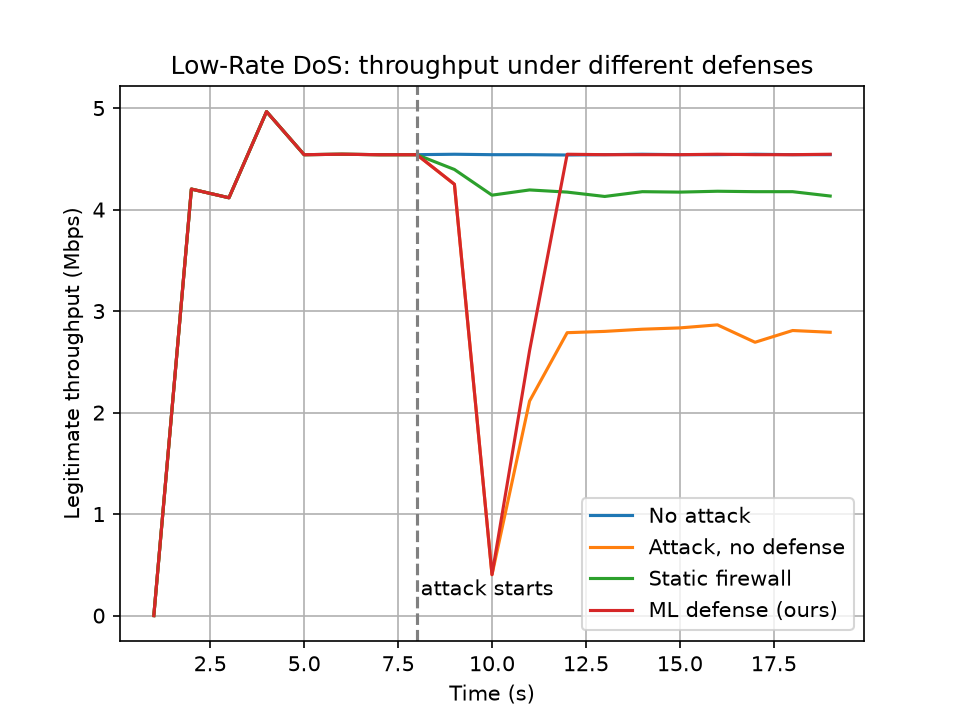

# NS3 Network Testbed with ML-Based Attack Detection and Defence

A simulated network testbed built in NS3 (version 3.45) and driven by Python 3.
It tests two attacks, DDoS and Low-Rate TCP DoS, and compares three cases:
no defence, a static rate-limit firewall, and an ML-based detect-and-block defence.

Authors: J. Jerusha Gracie and K.T. Subasri
Department of Electronics and Communication Engineering, Christ the King Engineering College

## What it does
1. NS3 simulates a legitimate user, attackers, routers R1 and R2, a 5 Mbps bottleneck link and a server.
2. Packets are captured at the bottleneck link (pcap).
3. Python converts the capture into per-second features.
4. The features are divided by each run's own normal values (relative features).
5. A Random Forest labels each second as normal or attack.
6. When an attack is flagged, the attackers are blocked at router R1.

## Main results (simulation)
| Attack | No defence | Static firewall | ML defence |
|---|---|---|---|
| Low-Rate TCP DoS (average of 4 settings) | 36.1% throughput loss | 7.7% | 0.16% |
| DDoS (5 attackers) | 84.6% | 41.2% | about 0% |

- Detection accuracy on unseen link speeds: 63.3% with raw features, 97.2% with relative features.
- Attacks were flagged in their first second, with no false alarms before the attack.

## Files
| File | Purpose |
|---|---|
| lowrate-test.cc | NS3 simulation of the Low-Rate TCP DoS |
| ddos-defense.cc | NS3 simulation of the DDoS |
| run_all.sh, run_hard.sh, run_compare.sh | Run batches of scenarios |
| build_lowrate_dataset.py, build_hard_dataset.py | Build labelled datasets from pcap files |
| train_relative.py | Train with relative features and test on unseen scenarios |
| phase2.py | Detect the attack, run the ML defence, print the final comparison |
| detect_ddos.py | Test the trained detector on the DDoS capture |
| plot_results.py | Draw the throughput comparison graph |
| *.csv | Datasets and final results |

## How to run
Requirements: Ubuntu (or WSL2), NS3 3.45, Python 3 with scapy, pandas, scikit-learn and matplotlib.

1. Copy lowrate-test.cc and ddos-defense.cc into the scratch folder of NS3 and run ./ns3 build.
2. Run bash run_all.sh and bash run_hard.sh.
3. Run python3 build_lowrate_dataset.py and python3 build_hard_dataset.py.
4. Run python3 train_relative.py.
5. Run bash run_compare.sh and then python3 phase2.py.

## Limitations
- This is a simulation, and each setting was run once.
- Detection runs offline: the detected second from one run is used as the block time in the next run.
- The firewall is a simplified rate cap, not a real firewall product.
- The block is instant and perfect in simulation.
- Evil Handshake, a nature-inspired defence and hardware validation are not done.

## Reference
Base paper: S. K. Shandilya, "Design and Deployment of Network Testbed for Web Data Security", Journal of Cyber Security and Mobility.
